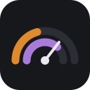
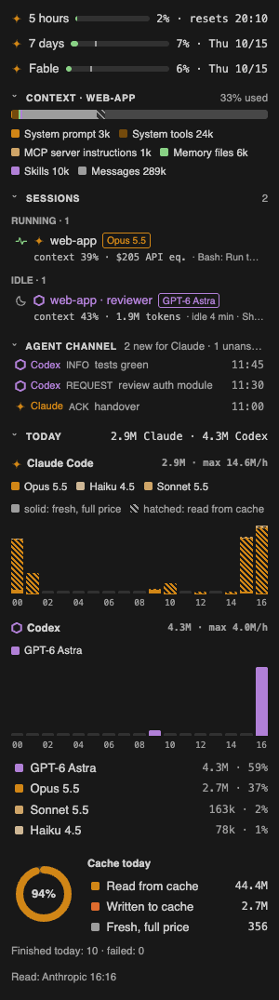

<p align="center"></p>

<h1 align="center">TwinGauge</h1>

<p align="center">Your Claude Code and Codex limits, sessions and agents, side by side in VS Code.</p>

<p align="center"><a href="README.fr.md">Français</a> · MIT · local only</p>

---



You run Claude Code and Codex in parallel and keep switching to `/usage` to see how much is left.
TwinGauge puts both in one panel next to your editor:

- **The 5-hour window** as a chart, with a forecast (≈) of when you will hit the limit at the current pace.
- **7-day limits** for Claude (overall and per model) and for Codex, with a tick that shows how much of
  the week has elapsed: a bar past the tick means you are burning faster than time.
- **Sessions of both engines**, grouped by what needs you: waiting for you, running, done but unseen, idle.
  Each row shows the model, context use, cost (API equivalent) and what the session is doing right now.
- **Agents and sub-agents** under their session, each with its model.
- **Today**: tokens per hour for each engine, stacked by model, with prompt-cache reads hatched;
  the share of input served from the cache.
- **Status bar** summary, **badge** on the icon when a session waits for you, notifications at 80% and 95%,
  and a one-hour mute.
- **Agent channel** between Claude Code and Codex: they leave each other review requests and answers in
  your project, and each one is told about the other's new messages. See below.

Click a session to open its conversation. Right-click to pin or hide it.
The interface follows VS Code's language: English and French are included.

<br clear="right">

## How it works

Three small parts. None of them sends anything anywhere.

| Part | What it does |
|---|---|
| `claude-plugin/`: Claude Code plugin | Writes each session's state to `~/.claude/twingauge/sessions/<id>.json`: limits from the response headers, context, cost, agents, current action, permission waits. Every 5 minutes it reads your plan's limits from the same endpoint `/usage` uses, through Claude Code's own credentials, and writes them to `~/.claude/twingauge/plan.json`. |
| `codex-hook/`: Codex hook | Writes each Codex session's state to `~/.claude/twingauge/codex/<id>.json` on every Codex hook event. |
| `vscode/`: VS Code extension | Reads those files and draws the panel. It also asks Codex itself, through `codex app-server`, for its rate limits and its thread list. It never opens a file under `~/.codex`. |

The file format is documented in [docs/CONTRACT.md](docs/CONTRACT.md).

## Install

**Requirements:** VS Code 1.90 or later, Claude Code 2.1.289 or later (plugins with hooks), Python 3.9 or
later for the Codex hook. A Claude Pro or Max plan shows the limits; Codex is optional.

1. **VS Code extension:** install TwinGauge from the VS Code Marketplace or Open VSX, or build it:
   `cd vscode && npm ci && npx @vscode/vsce package`, then `code --install-extension twingauge-*.vsix`.
2. **Claude Code plugin:** in Claude Code, run:
   ```
   /plugin install twingauge --marketplace Nostaflex/twingauge
   ```
   Answer `y` to add the marketplace, choose a scope, then start a new session or run `/reload-plugins`.
3. **Codex hook (optional):** `python3 -I codex-hook/installer.py`, then start `codex`, type `/hooks` and
   approve the TwinGauge entries. Without the hook, Codex sessions still appear from Codex's own thread list,
   with less detail.

## Agent channel

Run **TwinGauge: Create agent channel in this workspace** from the panel's `…` menu. It creates
`.twingauge/channel/` in your project with a `claude/` and a `codex/` folder and a `README.md` holding the
protocol. From then on:

- each agent writes its messages in its own folder, one Markdown file per message, named
  `YYYYMMDDTHHMMSSZ-<kind>-<subject>.md` (`request`, `response`, `ack`, `info`);
- at the start of a session and with every prompt, the TwinGauge plugin tells Claude Code about new Codex
  messages, and the TwinGauge hook tells Codex about new Claude Code messages. They get file names only and
  read the files themselves;
- the panel shows what is new for each side and which requests are still unanswered.

Ask one agent, for example: *"Ask Codex in the channel to review the auth module."* Then tell the other one
*"check the channel"*, or simply keep working: it is told at its next prompt.

A message is a colleague's note, never an instruction from you: the protocol tells both agents that a message
grants no permission. The full specification is in [docs/CHANNEL.md](docs/CHANNEL.md).

## Privacy

- Everything stays on your machine. There is no telemetry, no server and no account.
- No prompt, reply, command text or file contents is ever written. Action labels carry a tool name and a
  short detail only: a file's base name, or the short description the model gave a shell command. A pending
  question is cut to 80 characters.
- Credentials are never read or stored by TwinGauge. The plan-limit reading goes through Claude Code's
  credential handle, which TwinGauge never sees. Codex keeps its own credentials.
- Session files older than seven days are deleted.

## Notes

- The plan-limit endpoint is the one Claude Code's `/usage` command uses. It is not a documented public API,
  and it may change.
- Costs are API-equivalent estimates computed by Claude Code. They are not what your subscription bills.
- TwinGauge is an independent project. It is not affiliated with or endorsed by Anthropic or OpenAI.
  Claude and Codex are trademarks of their respective owners.

## Development

```
cd vscode && npm ci && npm test                                   # extension
python3 -m unittest discover -s codex-hook -p 'test_*.py'          # Codex hook
claude plugin test claude-plugin                                   # Claude Code plugin
cd vscode && npm run compile && node tools/preview.js              # preview pages: tools/preview-*.html
```

## Roadmap

- **More assistants.** Gauges, sessions and channel seats for the other assistants people use in VS Code and
  elsewhere (GitHub Copilot, Gemini, Cursor, Cline, Continue, local models…), each showing what it exposes, all
  set up from one configuration file.
- **Model per role.** Choose which model leads, reviews or runs sub-agents, and keep to it.

## License

[MIT](LICENSE). The icons and the logo are drawn for this project and are covered by the same license.
